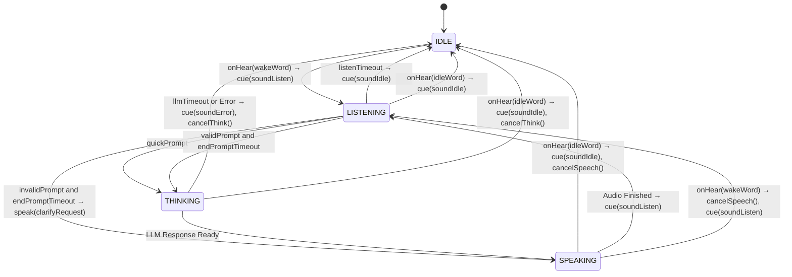

## Overview 

Traditional voice assistants/agent chat designs focus on half-duplex and full-duplex, which are two extremes ranging from rigid turn-taking to "anything goes" with multiple voices talking.
Neither extreme works well for a mindful human/agent dialog that can build shared understanding quickly and efficiently. 
With rigid turn-taking the human often has to deal with an agentic tsunami of words from an LLM trained to respond in massive detail.
With full-duplex comes the challenge of agents talking to themselves and humans having to interrupt constantly.

The IaPapo voice agent is designed to support mindful-duplex as a restrained version of full-duplex characterized by short, precise and meaningful exchanges of information.
Mindful-duplex avoids agentic bloviation in favor of light-weight rapid exchanges of atomic information.
Agents are trained to converge quickly to a "correct answer", even though different people need different correct answers. In other words, "correctness" is actually ambiguous. 
Response bloviation is a hack to avoid having to deal with conversational ambiguity.
Mindful-duplex minimizes bloviation by using a decision model to that guides the conversation towards specific patterns that are terse, crisp and atomic in their approach to building shared understanding.
A mindless conversation pattern would be to send an LLM a request to "explain quicksort" and get back a massive word tsunami. 
A mindful conversation pattern would be to send an LLM a request to "Explain quicksort in three sentences", which automatically leads to a terse (and ambiguous) response.
There are actually multiple mindful conversation patterns we use in daily life: "when will the store be restocked?", "a tomato is a fruit", "how do i convert from inches to centimeters?".

The existence of conversational patterns implies a need to classify them for processing.
And that is where a decision model comes in handy. 
A decision model can direct mindful conversation by classifying prompts so that an inference LLM can respond appropriately for a given conversation pattern.
Mindful-duplex is therefore built upon a foundation of atomic and nimble conversation patterns that foster mindful human/agent dialogs.

## Modeling Conversation

To explore patterns useful for mindful conversation, it is helpful to have a state machine that describes how any  given conversation might flow.

The following state diagram illustrates how we might use mindful conversation patterns to guide conversation.
The first pattern is clearly just the standard wakeWord which brings a voice assistant from IDLE to LISTENING.
Once the agent is LISTENING, then a quickPrompt pattern (e.g. "what time is it?") can be recognized and processed to provide an immediate response.
Or the user might provide a longPrompt (e.g., "tell me about The Beatles") that would lead to a few paragraphs that the user might need to interrupt if the response was too lengthy.
With longPrompt, we also need an idleWord that would bring the agent to IDLE once again.

**Example defaults:**
    * agentName is "IaPapo" (ee-a-PAH-poh)
    * llmTimeout is 60s
    * listenTimeout is 60s
    * endPromptTimeout is 3s
    * wakePause is 500ms
    * wakeWord is agentName followed by wakePause
    * idleWord is agentName

**Prompt classes** (a classifier labels the user's utterance):
    * quickPrompt: an immediate, well-understood request by convention. Goes to THINKING without waiting for endPromptTimeout.
    * validPrompt: a question, a demand, or a request for action.
    * invalidPrompt: thought babble. Answered with speak(clarifyRequest).

### Hardware/Software 

For simplicity, we assume a hardware/software environment having Apple MacOS/iOS 27+ with 2026 hardware, with a focus on iOS software that can also run on macOS without modification.
This Apple environment provides a rich set of tools for implementing on-device voice agents that can link to local or cloud inference models.

### Decisions
- Remote client required: iPhone, iPad, and the M4 Mac can each act as voice agent front end.
- Language split: one multiplatform SwiftUI app (iOS, iPadOS, macOS) with a shared Swift package for the state machine and LiveKit client. A platform layer handles audio and wake-word detection. The TypeScript code stays in its own process and is not translated.
- Each device runs its own state machine. Wake-word detection runs on-device, and only audio in LISTENING leaves the device.
- Transport: LiveKit. The turn pipeline (STT, Clef, TTS) runs on the M4 through lk-agent, and the LLM runs on the M5 Pro. Clef results and idle/cancel signals travel as data messages.
- Foreground only: we assume the app is in the foreground for the whole duration of the chat.

### Open Issues
- Duplex transitions, including exit from IDLE.
- Mute behavior across states (a mute word moves SPEAKING to IDLE).
- Self-echo: whether Clef must distinguish IaPapo's own output from user speech.
- Whether Clef's labels are per-state or shared.
- How prompt types drive transitions. Clef returns a probability per class and a confidence, so the threshold for fallback is open (see above).
- Whether planPrompt is dropped or kept under another name.
- Purpose of actionPrompt and explainPrompt.
- Clef's access to history.
- Confirmation rules for pi-coding-agent actions.
- Cloud call logging scope.
- Clef prompt-class fallback: below what confidence does Clef's answer fall back to validPrompt?
- M4 also serves gemma-4-26b-a4b-it-8bit on the oMLX server at localhost:7235. This undercuts the claim that the M4 avoids inference competition. Keep it, or remove it?
- On-device wake-word engine: Apple speech APIs or a small bundled model. Trade-offs: accuracy, battery, privacy.

### Glossary
- IaPapo: assistant name and wake word.
- Clef: decision model and router. Classifies raw STT into prompt types, using the current state machine. Served as `clef-flash-4bit` by the oMLX server at `localhost:7235` on the M4, through its `/v1/decisions` API. It is not a chat model and rejects `/v1/chat/completions`. Each answer carries a probability per class and a confidence.
- Prompt types: syncPrompt (a definitional prompt dedicated to aligning chat context between human and agent), actionPrompt, explainPrompt. Clef decides prompt types to guide state transitions. Purpose of actionPrompt and explainPrompt to be defined. The set is not fixed.
- Duplex: full duplex, with mindful state transitions driven by the wake word and idle word. Both sides can transmit at once, and the mic stays live in every state where the app is in the foreground. Standard full-duplex lets any sound interrupt, and it has known problems, so it is not the model.
- States (tactical, not final): IDLE, LISTENING, THINKING, SPEAKING.
- Hardware: M5 Pro 64GB runs the main chat LLM; its memory is dedicated to inference. M4 Pro 64GB runs voice processing (Whisper STT and Kokoro TTS) and Clef, all served by oMLX on `localhost:7235`, handling real-time needs so inference is not competing for resources. Open: that server also loads a gemma model (see Open Issues).
- Implementation: Swift app for Apple HW/SW integration. TypeScript codebase exists and is costly to translate. pi-coding-agent refers to the TypeScript version (@earendil-works/pi-coding-agent); Rust is not used.

